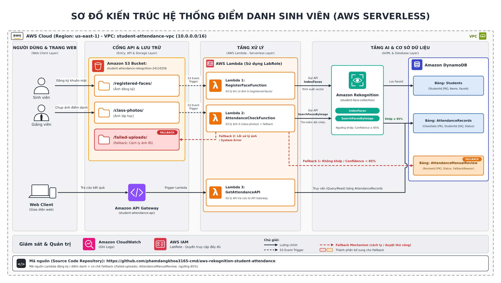

# AWS Rekognition Student Face Attendance System (Serverless Architecture)

Đồ án môn học: **Điện toán đám mây (Cloud Computing)** – Học kỳ 1, Năm học 2026–2027[span_2](start_span)[span_2](end_span)  
Đơn vị đào tạo: **Trường Đại học Công nghệ Kỹ thuật TP. Hồ Chí Minh (HCM-UTE)**[span_3](start_span)[span_3](end_span)  
**Giảng viên hướng dẫn:** ThS. Huỳnh Xuân Phụng[span_4](start_span)[span_4](end_span)  

### Nhóm sinh viên thực hiện:
- **Phạm Đăng Khoa** – MSSV: **24110256**
- **Huỳnh Quảng Tín** – MSSV: **24110353**

---

## 1. Giới thiệu tổng quan
Hệ thống điểm danh sinh viên tự động ứng dụng trí tuệ nhân tạo (AI/ML) theo mô hình phi máy chủ (**AWS Serverless**) triển khai thực tế trên nền tảng **AWS Learner Lab** (Region `us-east-1`)[span_5](start_span)[span_5](end_span). Hệ thống giải quyết bài toán điểm danh lớp học bằng cách đối soát khuôn mặt từ ảnh chụp tập thể lớp với kho vector đặc trưng sinh viên[span_6](start_span)[span_6](end_span)[span_7](start_span)[span_7](end_span), kết hợp cơ chế dự phòng đa tầng (**2-Tier Fallback Mechanism**) và bộ kiểm soát quyền riêng tư bằng kỹ thuật (**Privacy & Quota Guardrails**)[span_8](start_span)[span_8](end_span)[span_9](start_span)[span_9](end_span).

- **Link Video Demo hệ thống (YouTube):** https://youtu.be/_ZaR-7ncBaw
- **GitHub Repository:** https://github.com/phamdangkhoa3165-cmd/aws-rekognition-student-attendance[span_10](start_span)[span_10](end_span)

---

## 2. Kiến trúc hệ thống toàn trình (System Architecture)

[span_11](start_span)[span_11](end_span)

### Các thành phần dịch vụ AWS cốt lõi:
1. **Tầng Giao diện & Cổng API (Client & API Gateway Layer):**[span_12](start_span)[span_12](end_span)
   - **Web Client (`frontend/index.html`):** Giao diện quản trị hỗ trợ tra cứu kết quả điểm danh, phê duyệt danh sách chờ Fallback và tải ảnh lên S3 kèm hộp kiểm cam kết quyền riêng tư[span_13](start_span)[span_13](end_span)[span_14](start_span)[span_14](end_span).
   - **Amazon API Gateway (`student-attendance-api` - ID: `x6b3w242ib`):** REST API chuẩn Regional tại `us-east-1`[span_15](start_span)[span_15](end_span), cấu hình resource `/attendance` (hỗ trợ các phương thức `GET`, `POST`, `OPTIONS`), kích hoạt **Lambda Proxy Integration** và thiết lập **Throttling** (Rate: 10 req/s, Burst: 20 req/s)[span_16](start_span)[span_16](end_span).
2. **Tầng Lưu trữ & Kích hoạt sự kiện (Amazon S3):**[span_17](start_span)[span_17](end_span)
   - Bucket: `student-attendance-rekognition-24110256` kích hoạt **Block All Public Access: ON** 100% kết hợp cấu hình CORS[span_18](start_span)[span_18](end_span).
   - Thư mục `/registered-faces/`: Tiếp nhận ảnh chân dung sinh viên, kích hoạt S3 Event Trigger gọi `RegisterFaceFunction`[span_19](start_span)[span_19](end_span).
   - Thư mục `/class-photos/`: Tiếp nhận ảnh chụp lớp học, kích hoạt S3 Event Trigger gọi `AttendanceCheckFunction`[span_20](start_span)[span_20](end_span).
   - Thư mục `/failed-uploads/`: Vùng cách ly tự động các tệp ảnh lỗi hỏng định dạng hoặc lỗi hệ thống (Fallback 2)[span_21](start_span)[span_21](end_span).
   - Tải ảnh an toàn từ trình duyệt Web thông qua **S3 Pre-signed URL** (tự động hết hạn sau 300 giây).
3. **Tầng Xử lý phi máy chủ (AWS Lambda - Runtime Python 3.12, LabRole):**[span_22](start_span)[span_22](end_span)
   - **`RegisterFaceFunction`:** Đọc ảnh từ `/registered-faces/`, gọi API Rekognition `IndexFaces` nạp vector và lưu thông tin vào DynamoDB `Students`[span_23](start_span)[span_23](end_span).
   - **`AttendanceCheckFunction`:** Đọc ảnh từ `/class-photos/`, gọi Rekognition `SearchFacesByImage` (ngưỡng tương đồng >= 85%) để ghi nhận có mặt[span_24](start_span)[span_24](end_span), hoặc kích hoạt Fallback Mechanism khi không khớp hoặc lỗi tệp.
   - **`GetAttendanceAPI`:** Xử lý request từ API Gateway để truy vấn danh sách điểm danh[span_25](start_span)[span_25](end_span), cấp S3 Pre-signed URL (kiểm tra consent và quota khuôn mặt) và hỗ trợ giảng viên duyệt tay Fallback (`MANUAL_APPROVE`).
4. **Tầng AI & Cơ sở dữ liệu (AI/ML & Database Layer):**[span_26](start_span)[span_26](end_span)
   - **Amazon Rekognition:** Quản lý Vector Collection `student-face-collection` (chỉ lưu vector toán học, không lưu ảnh gốc)[span_27](start_span)[span_27](end_span).
   - **Amazon DynamoDB (On-Demand Mode):** Gồm 3 bảng[span_28](start_span)[span_28](end_span):
     - `Students` (PK: `StudentId`): Thông tin sinh viên và mã vector `FaceId`[span_29](start_span)[span_29](end_span).
     - `AttendanceRecords` (PK: `ClassDate`, SK: `StudentId`): Nhật ký điểm danh chính thức[span_30](start_span)[span_30](end_span).
     - `AttendanceManualReview` (PK: `ReviewId`): Hàng đợi duyệt dự phòng của cơ chế Fallback[span_31](start_span)[span_31](end_span).
5. **Tầng Giám sát & Quản trị (Amazon CloudWatch & IAM):**[span_32](start_span)[span_32](end_span)
   - **CloudWatch Logs:** Chuẩn hóa Log Groups cho 3 hàm Lambda với thời hạn lưu trữ **Retention = 14 days** nhằm tối ưu chi phí[span_33](start_span)[span_33](end_span).
   - **CloudWatch Alarm (`FaceAttendance-Lambda-Errors-Alarm`):** Cảnh báo tự động khi hàm xử lý điểm danh phát sinh lỗi (Errors >= 1 trong chu kỳ 5 phút).
   - **CloudWatch Dashboard (`FaceAttendance-Monitoring-Dashboard`):** Bảng theo dõi trực quan các chỉ số `Invocations`, `Duration`, `Errors` của hệ thống[span_34](start_span)[span_34](end_span).
   - **AWS IAM (`LabRole`):** Toàn bộ dịch vụ chạy dưới quyền thực thi có sẵn của AWS Learner Lab[span_35](start_span)[span_35](end_span)[span_36](start_span)[span_36](end_span).

---

## 3. Chính sách Quyền riêng tư & Kỹ thuật Kiểm soát Giới hạn (Privacy & Quota Guardrails)
Tuân thủ nghiêm ngặt yêu cầu đề tài và chỉ đạo của GVHD[span_37](start_span)[span_37](end_span)[span_38](start_span)[span_38](end_span):
- **Xác thực sự đồng ý (Consent Verification Gate):** Hệ thống chỉ thu thập và xử lý hình ảnh của thành viên nhóm hoặc cá nhân đã đồng ý cung cấp[span_39](start_span)[span_39](end_span). Trên giao diện Web và trong hàm `GetAttendanceAPI`, việc cấp Pre-signed URL upload ảnh yêu cầu cờ `privacy_consent == True`. Nếu người dùng không tích chọn xác nhận, API trả về mã lỗi `400 Bad Request (PRIVACY_CONSENT_REQUIRED)`[span_40](start_span)[span_40](end_span).
- **Thực thi giới hạn khuôn mặt bằng Code (Face Quota Enforcement):**
  - Giới hạn an toàn thử nghiệm: <= 50 khuôn mặt[span_41](start_span)[span_41](end_span).
  - Giới hạn tối đa toàn hệ thống: <= 1.000 khuôn mặt[span_42](start_span)[span_42](end_span).
  - Trước khi cấp Pre-signed URL đăng ký ảnh thẻ mới, Lambda tự động gọi `rekognition_client.describe_collection()` để kiểm tra chỉ số `FaceCount`. Nếu số lượng chạm ngưỡng, API lập tức chặn và trả về `403 Forbidden (FACE_QUOTA_EXCEEDED)`[span_43](start_span)[span_43](end_span).
- **Bảo mật dữ liệu lưu trữ:** S3 Bucket duy trì thiết lập **Block All Public Access: ON**. Không mở bất kỳ quyền truy cập công khai nào ra Internet.
- **Quy chuẩn Tagging:** Toàn bộ tài nguyên trên AWS đều được gắn thẻ: `Project: FaceAttendance` và `Owner: Khoa-Tin`[span_44](start_span)[span_44](end_span).

---

## 4. Cơ chế Dự phòng Đa tầng (2-Tier Fallback Mechanism)
Hệ thống thiết lập cơ chế xử lý dự phòng 2 tầng tại `src/lambda_attendance.py` và `src/lambda_get_attendance.py`[span_45](start_span)[span_45](end_span):

### Cấp độ 1: Recognition Fallback (Xử lý khi AI nhận diện không khớp hoặc độ tin cậy thấp)
- **Điều kiện kích hoạt:** Khuôn mặt bị mờ, góc nghiêng, thiếu sáng, sinh viên chưa đăng ký hoặc độ tương đồng Similarity < 85%[span_46](start_span)[span_46](end_span).
- **Xử lý tự động:** Hàm Lambda ghi nhận bản ghi vào bảng `AttendanceManualReview` với trạng thái `PENDING_MANUAL_REVIEW` và lưu đường dẫn ảnh gốc[span_47](start_span)[span_47](end_span)[span_48](start_span)[span_48](end_span).
- **Khắc phục:** Giảng viên đối chiếu ảnh gốc trực tiếp trên Web Dashboard và bấm nút **Duyệt tay MSSV** (`MANUAL_APPROVE`) để chuyển sinh viên sang bảng chính thức với cờ `VerificationType = MANUAL_FALLBACK_APPROVED`[span_49](start_span)[span_49](end_span).

### Cấp độ 2: System Fault-Tolerance Fallback (Xử lý lỗi tệp hỏng hoặc sự cố hạ tầng)
- **Điều kiện kích hoạt:** Tải lên tệp ảnh hỏng định dạng (`InvalidImageFormatException`), vượt dung lượng hoặc Rekognition bị giới hạn tần suất (Rate Limit/Throttling).
- **Xử lý tự động:** Khối `try...except ClientError` trong Lambda tự động di chuyển tệp lỗi sang thư mục cách ly `/failed-uploads/` trên S3 để giải phóng luồng xử lý[span_50](start_span)[span_50](end_span), đồng thời ghi log mã lỗi vào bảng `AttendanceManualReview` (`Status = SYSTEM_ERROR_ISOLATED`) và phát tín hiệu cảnh báo lên CloudWatch Logs.

---

## 5. Tiến độ thực hiện & Kết quả Kiểm thử (Roadmap)

### Bảng theo dõi tiến độ tổng thể 4 tuần:
- [x] **Tuần 1:** Thiết kế sơ đồ kiến trúc Serverless, khởi tạo VPC, kiểm tra IAM `LabRole`, tạo S3 Bucket (3 thư mục), 3 bảng DynamoDB On-demand, khởi tạo Rekognition Collection bằng AWS CLI và thiết kế Fallback Mechanism[span_51](start_span)[span_51](end_span)[span_52](start_span)[span_52](end_span).
- [x] **Tuần 2:** Triển khai 3 hàm AWS Lambda (`RegisterFaceFunction`, `AttendanceCheckFunction`, `GetAttendanceAPI`), cấu hình S3 Event Triggers và kiểm thử thành công 5 kịch bản thành phần (TC-01 đến TC-05)[span_53](start_span)[span_53](end_span).
- [x] **Tuần 3:** Tích hợp Amazon API Gateway (CORS, Throttling), xây dựng Web Client Dashboard, thực thi kỹ thuật bảo mật quyền riêng tư & hạn mức 1.000 khuôn mặt, cấu hình CloudWatch (Logs retention, Alarm, Dashboard) và viết template CloudFormation IaC[span_54](start_span)[span_54](end_span)[span_55](start_span)[span_55](end_span).
- [x] **Tuần 4:** Kiểm thử toàn trình (End-to-End Testing với 2 kịch bản chặn 400 & 403), đánh giá tối ưu chi phí (Cost Optimization), dọn dẹp tài nguyên (`scripts/cleanup_resources.sh`), hoàn thiện tài liệu báo cáo tổng kết và phát hành Video Demo (<= 10 phút)[span_56](start_span)[span_56](end_span)[span_57](start_span)[span_57](end_span)[span_58](start_span)[span_58](end_span).

### Bảng kết quả kiểm thử toàn trình End-to-End (Tuần 4):

| Mã Test | Kịch bản kiểm thử End-to-End | Dữ liệu đầu vào (Input) | Kết quả thực tế trên AWS (Actual Output) | Trạng thái |
| :---: | :--- | :--- | :--- | :---: |
| **E2E-01** | **Chặn thiếu Consent (Privacy Gate)** | Chọn ảnh thẻ, bỏ chọn checkbox Quyền riêng tư | API Gateway & Lambda chặn, trả về `HTTP 400 Bad Request` (`PRIVACY_CONSENT_REQUIRED`); không cấp URL[span_59](start_span)[span_59](end_span). | **PASS** |
| **E2E-02** | **Chặn vượt Quota khuôn mặt** | Chọn đăng ký mới, chọn Quota Test Mode = 2, Collection đã có 2 mặt | Lambda đối chiếu `FaceCount >= 2`, lập tức chặn và trả về `HTTP 403 Forbidden` (`FACE_QUOTA_EXCEEDED`)[span_60](start_span)[span_60](end_span)[span_61](start_span)[span_61](end_span). | **PASS** |
| **E2E-03** | **Điểm danh tự động thành công (Happy Path)** | Upload ảnh lớp học hợp lệ vào `/class-photos/` | Web nhận `HTTP 200 OK`, S3 trigger Lambda 2; Rekognition khớp mặt >= 85%; bảng `AttendanceRecords` ghi `PRESENT`[span_62](start_span)[span_62](end_span)[span_63](start_span)[span_63](end_span). | **PASS** |
| **E2E-04** | **Fallback 1 & Duyệt tay Giảng viên** | Upload ảnh người chưa đăng ký hoặc ảnh mờ | Rơi vào bảng `AttendanceManualReview`; Giảng viên bấm Duyệt tay MSSV trên Web chuyển sang bản ghi có mặt hợp lệ[span_64](start_span)[span_64](end_span). | **PASS** |
| **E2E-05** | **Fallback 2 & Giám sát CloudWatch** | Upload tệp ảnh lỗi hỏng định dạng | File được di chuyển sang `/failed-uploads/`[span_65](start_span)[span_65](end_span), bảng ghi `SYSTEM_ERROR_ISOLATED`; CloudWatch Dashboard cập nhật chỉ số lỗi[span_66](start_span)[span_66](end_span). | **PASS** |

---

## 6. Cấu trúc thư mục & Danh mục liên kết trực tiếp (Direct Links)

    aws-rekognition-student-attendance/
    ├── README.md                          # Tài liệu tổng quan, kiến trúc, Fallback, Privacy & kiểm thử
    ├── docs/
    │   ├── architecture_diagram.jpg       # Sơ đồ kiến trúc hệ thống AWS Serverless
    │   └── final_report.md                # Báo cáo tổng kết đồ án môn học cuối kỳ
    ├── frontend/
    │   └── index.html                     # Giao diện Web xem điểm danh, duyệt Fallback & tải ảnh
    ├── iac/
    │   └── cloudformation_template.yaml   # Bản mẫu CloudFormation tự động hóa hạ tầng (IaC)
    ├── scripts/
    │   ├── setup_infrastructure.sh        # Script AWS CLI khởi tạo hạ tầng nền tảng
    │   └── cleanup_resources.sh           # Script AWS CLI dọn dẹp tài nguyên & tệp kiểm thử tạm
    ├── src/
    │   ├── lambda_register.py             # Lambda 1: Đăng ký khuôn mặt sinh viên (IndexFaces)
    │   ├── lambda_attendance.py           # Lambda 2: Điểm danh & Fallback 2 tầng (SearchFacesByImage)
    │   └── lambda_get_attendance.py       # Lambda 3: API Gateway Proxy, Pre-signed URL & Quota check
    ├── tests/
    │   └── test_events.json               # Bộ dữ liệu JSON payload kiểm thử các hàm Lambda
    └── evidence/
        ├── 01_s3_buckets_and_folders.jpg  # Minh chứng Tuần 1: S3 Bucket & các thư mục
        ├── 02_dynamodb_3_tables.jpg       # Minh chứng Tuần 1: 3 bảng DynamoDB Active
        ├── 03_rekognition_cli_status.jpg  # Minh chứng Tuần 1: Khởi tạo Rekognition Collection
        ├── 04_iam_labrole.jpg             # Minh chứng Tuần 1: Quyền IAM LabRole
        ├── 05_vpc_overview.jpg            # Minh chứng Tuần 1: Mạng VPC nền tảng
        ├── week2/                         # Thư mục 8 ảnh minh chứng triển khai Lambda & kiểm thử Tuần 2
        ├── week3/                         # Thư mục 8 ảnh minh chứng API Gateway, Web, Privacy & CloudWatch
        └── week4/                         # Thư mục 7 ảnh minh chứng kiểm thử E2E, Billing & Cleanup

### Danh mục liên kết trực tiếp:
- **Tài liệu Báo cáo Cuối kỳ:** [`docs/final_report.md`](docs/final_report.md)
- **Mã nguồn Lambda:** [`src/lambda_register.py`](src/lambda_register.py) | [`src/lambda_attendance.py`](src/lambda_attendance.py) | [`src/lambda_get_attendance.py`](src/lambda_get_attendance.py)
- **Giao diện Web Client:** [`frontend/index.html`](frontend/index.html)
- **Bản mẫu IaC CloudFormation:** [`iac/cloudformation_template.yaml`](iac/cloudformation_template.yaml)
- **Script Dọn dẹp Tài nguyên:** [`scripts/cleanup_resources.sh`](scripts/cleanup_resources.sh)
- **Minh chứng Tuần 1 (Đã chuẩn hóa tên file):**  
  [`evidence/01_s3_buckets_and_folders.jpg`](evidence/01_s3_buckets_and_folders.jpg)[span_67](start_span)[span_67](end_span)[span_68](start_span)[span_68](end_span) | [`evidence/02_dynamodb_3_tables.jpg`](evidence/02_dynamodb_3_tables.jpg)[span_69](start_span)[span_69](end_span)[span_70](start_span)[span_70](end_span) | [`evidence/03_rekognition_cli_status.jpg`](evidence/03_rekognition_cli_status.jpg)[span_71](start_span)[span_71](end_span)[span_72](start_span)[span_72](end_span) | [`evidence/04_iam_labrole.jpg`](evidence/04_iam_labrole.jpg)[span_73](start_span)[span_73](end_span)[span_74](start_span)[span_74](end_span) | [`evidence/05_vpc_overview.jpg`](evidence/05_vpc_overview.jpg)[span_75](start_span)[span_75](end_span)[span_76](start_span)[span_76](end_span)
- **Minh chứng Tuần 2:** [`evidence/week2/`](evidence/week2/)[span_77](start_span)[span_77](end_span)[span_78](start_span)[span_78](end_span)
- **Minh chứng Tuần 3:** [`evidence/week3/`](evidence/week3/)[span_79](start_span)[span_79](end_span)[span_80](start_span)[span_80](end_span)
- **Minh chứng Tuần 4:** [`evidence/week4/`](evidence/week4/)[span_81](start_span)[span_81](end_span)

---

## 7. Hướng dẫn chạy thử nghiệm Web Client

1. Mở trực tiếp tệp [`frontend/index.html`](frontend/index.html) trên trình duyệt Web (Chrome, Edge, Cốc Cốc)[span_82](start_span)[span_82](end_span).
2. Dán đường dẫn API Gateway Invoke URL của hệ thống:
   `[https://x6b3w242ib.execute-api.us-east-1.amazonaws.com/prod/attendance](https://x6b3w242ib.execute-api.us-east-1.amazonaws.com/prod/attendance)`
3. Nhấn nút **"Làm mới Dữ liệu"** để đồng bộ danh sách điểm danh và hàng đợi Fallback[span_83](start_span)[span_83](end_span).
4. Kiểm thử các luồng hoạt động:
   - **Thử nghiệm chặn HTTP 400:** Chọn tệp ảnh, bỏ chọn ô cam kết Quyền riêng tư, bấm nút tải ảnh[span_84](start_span)[span_84](end_span).
   - **Thử nghiệm chặn HTTP 403:** Chọn `Đăng ký khuôn mặt mới`, chọn `Chế độ kiểm thử chặn vượt Quota (Giới hạn = 2)`, tích chọn cam kết, bấm nút tải ảnh[span_85](start_span)[span_85](end_span).
   - **Thử nghiệm điểm danh HTTP 200:** Chọn `Điểm danh lớp học`, chọn ngưỡng chuẩn, tích chọn cam kết, bấm nút tải ảnh và kiểm tra bảng kết quả sau 5 giây[span_86](start_span)[span_86](end_span).
